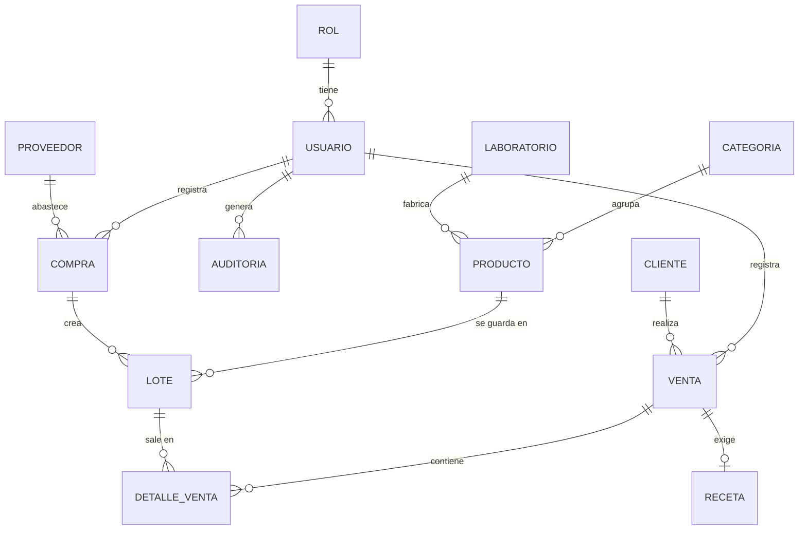

<div align="center">

# 💊 SIGF — Sistema Integral de Gestión Farmacéutica

**Aplicación de escritorio para administrar una farmacia: inventario por lotes con vencimientos, ventas, compras, recetas, usuarios y reportes.**


</div>

---

## 📌 Sobre el proyecto

El **SIGF** es un sistema de gestión pensado para el día a día de una farmacia. Controla el inventario **por lotes y fechas de vencimiento**, registra ventas y compras, exige receta para los medicamentos controlados y deja trazabilidad de cada movimiento.

Lo que lo diferencia de un sistema de tienda común:

| | Característica | Qué significa |
|---|---|---|
| 📦 | **Lotes con vencimiento (FEFO)** | Cada venta descuenta automáticamente del lote que vence primero. Nunca se vende un lote vencido. |
| 🩺 | **Medicamentos controlados** | Antes de venderlos, el sistema exige los datos de la receta. |
| 🔍 | **Trazabilidad** | Cada venta registra qué lote salió y qué usuario la hizo. |
| 🔒 | **Stock siempre consistente** | El stock nunca queda negativo, aunque dos cajas vendan al mismo tiempo (`SELECT ... FOR UPDATE`). |
| ⏱️ | **Alertas en segundo plano** | Hilos que avisan de productos por vencer y con stock bajo sin congelar la interfaz. |

## ✨ Funcionalidades

- **Inventario:** productos, categorías, laboratorios y lotes, con colores según el vencimiento.
- **Punto de venta:** carrito, búsqueda con autocompletado, lector de código de barras, métodos de pago, factura y anulación.
- **Compras:** ingreso de mercadería a proveedores que crea los lotes nuevos, dentro de una transacción.
- **Recetas:** registro obligatorio para medicamentos controlados.
- **Usuarios y roles:** acceso según el rol, con contraseñas cifradas con BCrypt.
- **Dashboard:** ventas del día, lotes por vencer, stock bajo y gráficos.
- **Reportes PDF:** ventas por fecha, productos más vendidos e inventario valorizado.
- **Auditoría:** registro de anulaciones y ajustes de inventario.
- **Respaldos automáticos** de la base de datos con `pg_dump`.

## 👥 Roles

| Rol | Acceso |
|---|---|
| **ADMIN** | Todo el sistema |
| **FARMACEUTICO** | Inventario, compras y recetas |
| **CAJERO** | Solo ventas |

## 🛠️ Tecnologías

| Área | Tecnología |
|---|---|
| Lenguaje | Java 17+ |
| Interfaz | JavaFX (FXML + Scene Builder), AtlantaFX, Ikonli, ControlsFX |
| Base de datos | PostgreSQL con JDBC puro y pool HikariCP |
| Seguridad | BCrypt |
| Reportes | JasperReports |
| Concurrencia | `ExecutorService`, `ScheduledExecutorService`, `Task`/`Service` de JavaFX |
| Build | Maven |
| Pruebas | JUnit 5 |

## 🏗️ Arquitectura

Arquitectura en capas. El controlador nunca habla con la base de datos directamente:

```
Vista (FXML) → Controller → Service → DAO → PostgreSQL
```

```
sigf/
├── pom.xml
├── database/
│   ├── schema.sql
│   └── seed.sql
└── src/main/
    ├── java/com/sigf/
    │   ├── App.java
    │   ├── config/        conexión HikariCP y propiedades
    │   ├── model/         Producto, Lote, Venta, Usuario...
    │   ├── dao/           acceso a datos con PreparedStatement
    │   ├── service/       reglas de negocio y transacciones
    │   ├── controller/    un controlador por vista FXML
    │   ├── task/          alertas, respaldos y tareas en segundo plano
    │   └── util/          sesión, validaciones, formatos, navegación
    └── resources/com/sigf/
        ├── view/          archivos .fxml
        ├── css/           estilos.css
        ├── img/
        └── reports/       plantillas .jrxml
```

## 🗄️ Modelo de datos

El stock vive en los **lotes**, no en el producto. Por eso el detalle de venta apunta al lote.



## 🗺️ Hoja de ruta

- [ ] **Fase 0:** planificación y entorno
- [ ] **Fase 1:** base de datos y acceso a datos
- [ ] **Fase 2:** login, roles y estructura de la interfaz
- [ ] **Fase 3:** catálogo e inventario
- [ ] **Fase 4:** compras
- [ ] **Fase 5:** ventas (punto de venta) ← *versión entregable*
- [ ] **Fase 6:** hilos y alertas
- [ ] **Fase 7:** dashboard y reportes
- [ ] **Fase 8:** pulido, auditoría y entrega

## 🚀 Instalación y ejecución

> 🚧 Esta sección se completará cuando el proyecto tenga su primera versión ejecutable.

**Requisitos:**
- JDK 17 o superior
- Maven 3.9+
- PostgreSQL 15+

**Pasos (previstos):**
```bash
# 1. Clonar el repositorio
git clone https://github.com/zepedaG06/SIGF-Sistema_Integral_De_Gestion_Farmaceutico.git
cd SIGF-Sistema_Integral_De_Gestion_Farmaceutico

# 2. Crear la base de datos y cargar los datos de prueba
psql -U postgres -c "CREATE DATABASE sigf;"
psql -U postgres -d sigf -f database/schema.sql
psql -U postgres -d sigf -f database/seed.sql

# 3. Configurar la conexión
cp src/main/resources/com/sigf/config.example.properties src/main/resources/com/sigf/config.properties
#    (editar URL, usuario y contraseña)

# 4. Ejecutar
mvn clean javafx:run
```

## 🤝 Cómo contribuir (equipo)

- La rama `main` siempre compila. Nadie trabaja directamente en ella.
- Una rama por tarea: `feature/login`, `feature/ventas`, `fix/stock-negativo`.
- Commits pequeños con mensajes claros.
- Todo cambio entra por **pull request** revisado por otro integrante.
- Los cambios a la base de datos van solo en `database/schema.sql`, avisando al equipo.

## 👨‍💻 Equipo

| Integrante | Módulos |
|---|---|
| _[nombre]_ | Base de datos, login y roles, usuarios, auditoría |
| _[nombre]_ | Catálogo, inventario, compras, alertas |
| _[nombre]_ | Ventas, recetas, dashboard, reportes |

---

<div align="center">
Proyecto universitario · 2026
</div>
